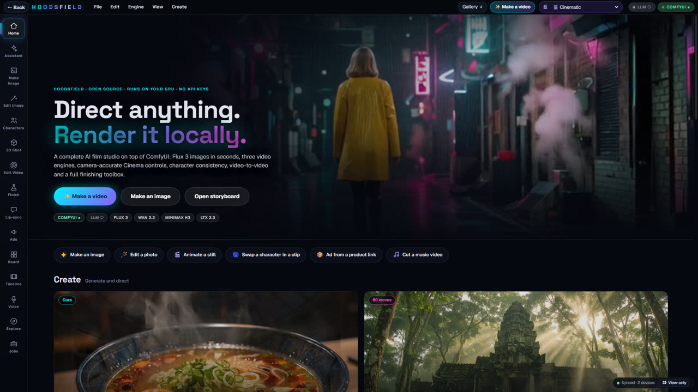
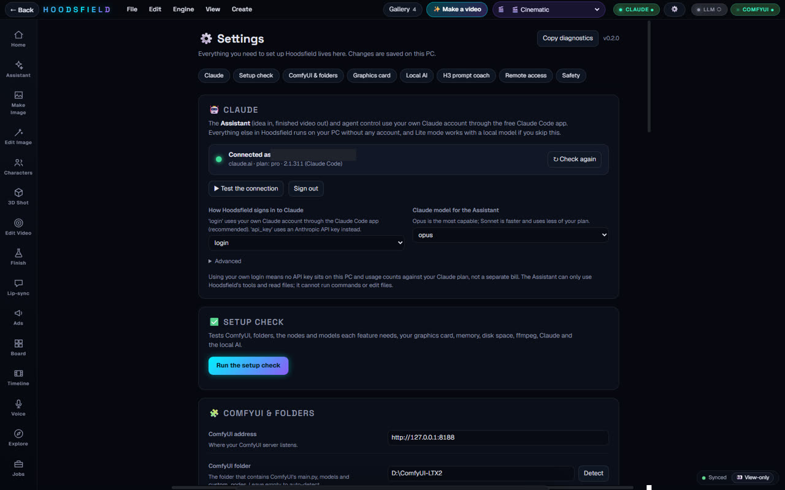
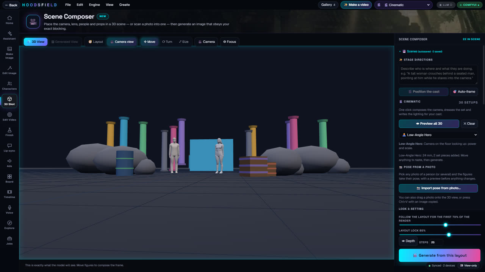
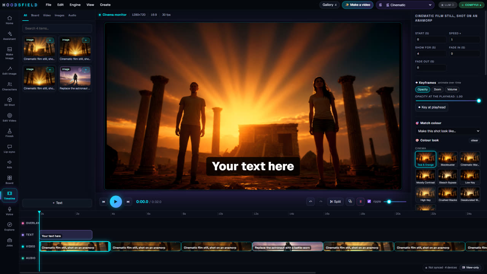
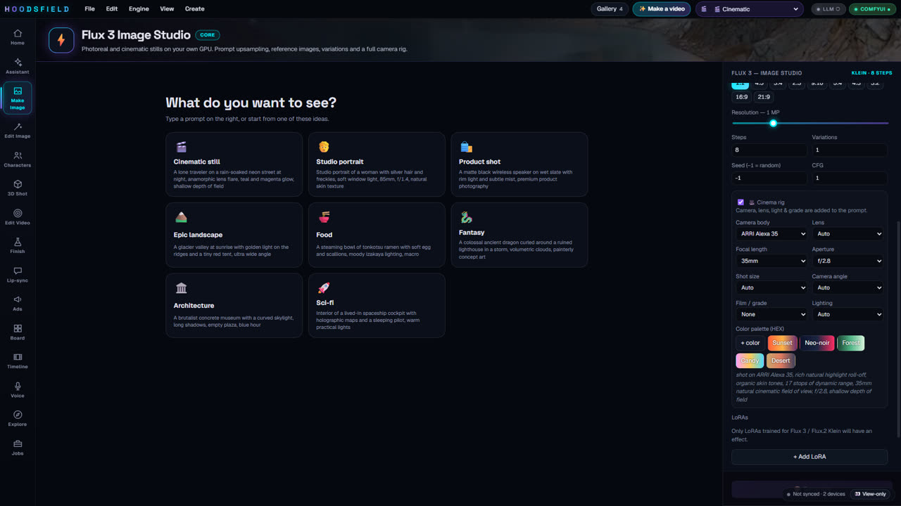
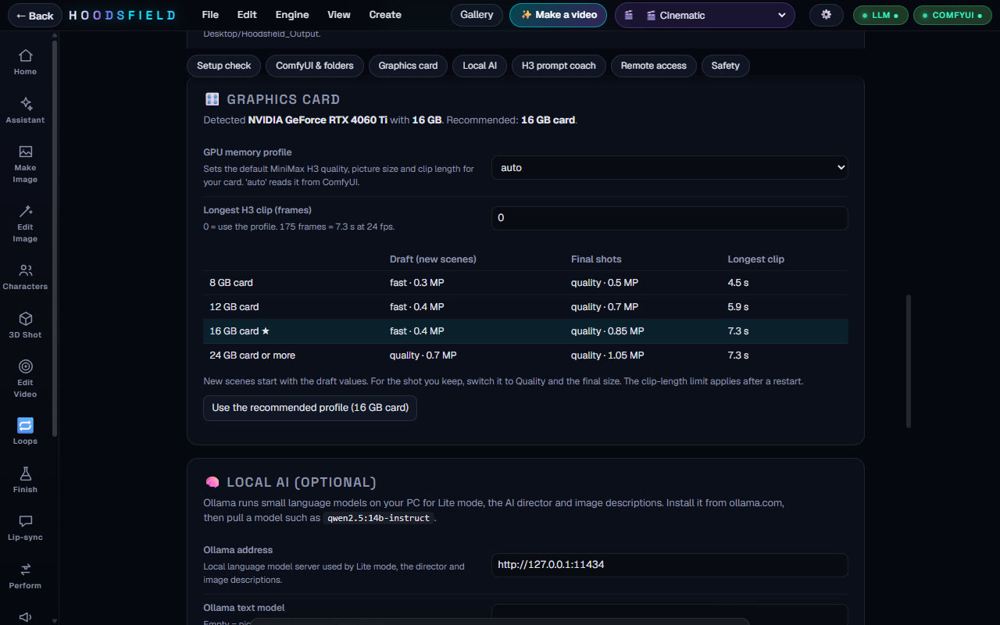
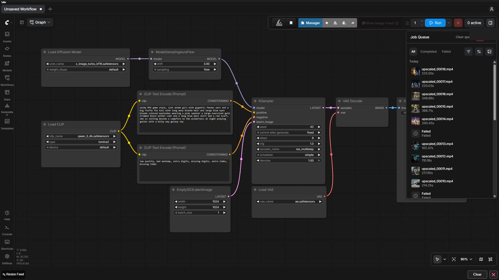

# Hoodsfield

**A local-first AI film studio built on ComfyUI.** Storyboard, generate, edit and cut a short film on your own GPU: no API keys, no cloud, no per-clip fees.

Hoodsfield is a React + FastAPI app that drives a local [ComfyUI](https://github.com/comfyanonymous/ComfyUI) server. It was built for Comfy's *Open Source Higgsfield* contest, and its promo reel and walkthrough were made with Hoodsfield itself.



## Quick start

You need a Windows PC with an NVIDIA GPU, [ComfyUI](https://github.com/comfyanonymous/ComfyUI) installed with the models for the engines you want, [Python 3.10+](https://www.python.org/downloads/) and [Node.js 18+](https://nodejs.org/) (Node is used once, to build the web UI).

```bat
git clone https://github.com/designn2future/hoodsfield-ai
cd hoodsfield-ai
Install_Hoodsfield.bat
Start_Hoodsfield.bat
```

1. **`Install_Hoodsfield.bat`** creates the Python environment, installs the packages and builds the web UI. It is safe to run again.
2. **`Start_Hoodsfield.bat`** starts ComfyUI (if it is not running) and the studio, then opens <http://localhost:8000>.
3. The first time, a short **setup check** opens. If it cannot find your ComfyUI folder it opens **Settings** for you. Everything below is set there; there are no files to edit.

Full walk-through, including ComfyUI nodes and models: [docs/SETUP.md](docs/SETUP.md). Something not working: [docs/TROUBLESHOOTING.md](docs/TROUBLESHOOTING.md).

## Connect Claude (for the Assistant)

The **Assistant** turns one idea into a finished video: it writes, makes the pictures and clips, builds the cut, and asks for your OK at the key points. It runs on **your own Claude account** through the free Claude Code app, so there is no API key to manage and usage counts against your normal Claude plan.

Open **Settings → Claude**:

| You see | What to do |
|---|---|
| **Not installed** | Copy the one-line install command shown there, run it in a terminal, click *Check again*. |
| **Not signed in** | Click *Sign in with your Claude account*. A window opens and your browser asks you to approve. |
| **Connected as you@example.com** | Click *Test the connection* once to confirm. Pick Opus or Sonnet. |

No Claude account? Everything except the Assistant works without one, and **Lite mode** runs the Assistant on a local Ollama model. Details, the API-key option and what the Assistant is allowed to do: [docs/CLAUDE.md](docs/CLAUDE.md).



## What it does

| Area | Highlights |
|---|---|
| **Image** | Flux 3 text-to-image with a Cinema rig (camera, lens, light, film look); reference images; Qwen / Flux 3 instruction editing with brush masks; before/after slider in Explore |
| **Video** | MiniMax H3 (primary, picture and sound in one pass), LTX 2.3 and Wan 2.2 image-to-video; extend any clip from its last frame; Genjutsu video-to-video (motion transfer, object swap, restyle) |
| **Scene Composer** | Block a shot in 3D (props, posable figures, camera), then render it through depth-controlled generation |
| **Characters** | Consistent characters from a photo: turnaround sheets, outfit lock, and a voice for each character that Voice, Lip-sync and Ads use automatically |
| **Swap & Perform** | Replace a person in a clip with your character and have them perform the clip's own audio (rap, song, speech), lips in sync. [Guide](docs/PERFORM.md) |
| **Ads** | Product link or photo to an ad storyboard; pick a presenter character who holds your product and speaks to the camera in their own voice |
| **Timeline editor** | Multi-track editor: grades, LUTs, effects, camera moves, keyframes, shot-matching colour, beat detection, auto-captions, animated titles, background removal to transparent WebM, ffmpeg export |
| **Audio and lip-sync** | Stable Audio ambience; local voiceover that clones a voice from a short clip (Chatterbox); lip-sync that feeds the recorded voice into MiniMax H3, which makes the face and the sound together so the mouth follows the words |
| **Video Lab** | Real-ESRGAN upscale (long clips are split automatically so memory never runs out), RIFE slow-mo, BiRefNet cutouts, reverse, loop, reframe and more |
| **Seamless Loops** | Study / lofi / sleep videos: animate one picture with gentle motion, build a loop whose end hands over to its start with no visible seam, upscale it, then export hours of it with your music. [Guide](docs/LOOPS.md) |
| **Assistant** | Idea in, finished video out, with approvals. Claude account or local Lite mode |
| **Settings** | One page for Claude, ComfyUI folders, GPU profile, local AI, prompt coach, remote-access login and safety limits, plus a first-run setup check |
| **Extras** | Phone/foldable layout, PC and phone share one session, optional remote access behind a login, an MCP server so any agent can drive the studio |

<p>


</p>
<p>


</p>

## Seamless study loops

The long "study with me" and lofi videos on YouTube are one calm scene with a little motion that repeats for hours. **Loops** (left rail) makes them: animate a picture with MiniMax H3 or Wan 2.2, let Hoodsfield find the point where the clip matches itself best and blend the join, check the seam rating, optionally upscale to 1080p, hold the picture perfectly still (AI video drifts, and drift is what makes a plain loop dissolve), then export 10 minutes to 3 hours with your music. The picture is copied rather than re-encoded, so a 3 hour video takes seconds and every repeat is identical. A second, GPU-free way builds loops from layers (a still picture plus rain, snow, petals, fireflies, stars, mist, aurora, waterfall flow and more, blended like an After Effects comp) that are seamless by construction, and four ready-made **templates** (enchanted paradise, cozy rainy study room, snowy cabin night, neon rain alley) open with their layers set up so you can see how it works. Details: [docs/LOOPS.md](docs/LOOPS.md).

## Everything is a ComfyUI workflow

Every generation is a workflow sent to your ComfyUI, and you can watch it run there. Hoodsfield adds the studio around it: prompts, scenes, characters, the timeline and the finishing tools.



## Settings

Open **View → Settings** (or the gear icon). Changes are saved to `app/backend/hoodsfield_settings.json` on your PC.

| Section | What you set |
|---|---|
| Claude | Sign-in method (your account or an API key), model, test the connection |
| Setup check | One click tests ComfyUI, folders, nodes, models, GPU, RAM, disk, ffmpeg, Claude and Ollama, with a fix hint for each problem |
| ComfyUI & folders | ComfyUI address and folder (with auto-detect), extra model folders, start-up options for the auto-restart, work and output folders |
| Graphics card | 8, 12, 16 or 24 GB profile: default draft quality and longest clip for MiniMax H3. `auto` reads your card from ComfyUI |
| Local AI | Ollama address and models for Lite mode, the AI director and image descriptions |
| H3 prompt coach | Switch the coach on or off, install the matching Claude Code skill |
| Remote access | The login required when you open Hoodsfield from the internet |
| Safety | The memory guard that keeps Windows responsive during big renders |

`Copy diagnostics` in Settings puts a short report (versions, GPU, check results, no secrets) on your clipboard for bug reports.

## Requirements

- Windows 10/11 (the launcher scripts are `.bat`; the Python and web code is portable)
- NVIDIA GPU. Developed on an RTX 4060 Ti 16 GB with 48 GB RAM. Smaller cards work with smaller models: pick your card in Settings → Graphics card.
- ComfyUI with the custom nodes and models for the engines you want to use. The in-app **Model manager** and the **setup check** list what is missing for each tool.
- Python 3.10+, Node 18+ (build only), ffmpeg (bundled through `imageio-ffmpeg`)
- Optional: [Claude Code](https://docs.claude.com/en/docs/claude-code/setup) for the Assistant, [Ollama](https://ollama.com) for Lite mode

Model weights are **not** included and each has its own licence (Flux 3, MiniMax H3, LTX, Wan, Qwen, Stable Audio, Real-ESRGAN, BiRefNet). Check them before commercial use. Where to get each file: [docs/MODELS.md](docs/MODELS.md).

## Notes for low-VRAM or PCIe-limited GPUs

On a 16 GB card, anything else holding VRAM (Chrome WebGL tabs, remote desktop) can slow renders about 10x because weights stream over PCIe. Close other GPU apps while rendering. The Settings page has a profile for 8 and 12 GB cards.

## H3 prompt coach

MiniMax H3 renders picture and sound in one pass, so a prompt works best as a short production brief. Every H3 request in Hoodsfield passes through `app/backend/h3_coach.py`, which keeps your wording and adds what H3 needs: an explicit camera line, a gravity/physics line for falls and impacts, layered audio, a constraints list (no stray text, morphing, extra limbs or cuts), and the lock-to-still instruction for image-to-video. Next to the H3 prompt box, **Prompt coach** shows exactly what will be sent. Switch it off in Settings, per request with `coach=false`, or globally with `H3_COACH=0`.

The same guidance is available as an agent skill in [`docs/skills/minimax-h3-prompting`](docs/skills/minimax-h3-prompting/SKILL.md). Settings → H3 prompt coach installs it for Claude Code with one click.

## Configuration

Everything has a field in Settings. For scripts, the same options exist as environment variables or in `app/backend/.env`:

| Variable | Default | Purpose |
|---|---|---|
| `COMFY_URL` | `http://127.0.0.1:8188` | ComfyUI server |
| `COMFY_ROOT` | auto-detected | ComfyUI install folder |
| `VSA_WORK_DIR` | system temp `vsa_work` | Job database and outputs |
| `EXTRA_MODEL_DIRS` | none | More folders to look for models (separate with `;`) |
| `HOODSFIELD_SETTINGS` | `backend/hoodsfield_settings.json` | Where Settings are saved |
| `HF_AUTH_FILE` | `backend/hf_auth.json` | Remote-access login (set in Settings or `Set_Remote_Password.bat`) |

Priority, lowest to highest: built-in defaults, environment, `.env`, Settings.

## Development

```bat
cd app\backend && .venv\Scripts\python main.py      :: the studio on :8000
cd app\frontend && npm run dev                      :: the web UI with hot reload
```

See [CONTRIBUTING.md](CONTRIBUTING.md) and [SECURITY.md](SECURITY.md).

## Licence

Apache-2.0, see [LICENSE](LICENSE). The app code is open source. Model weights and third-party ComfyUI nodes are under their own licences.
